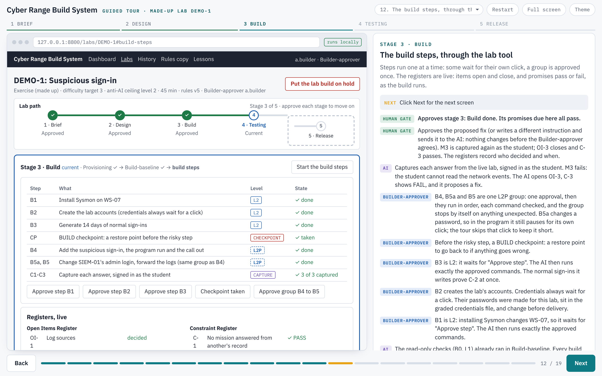
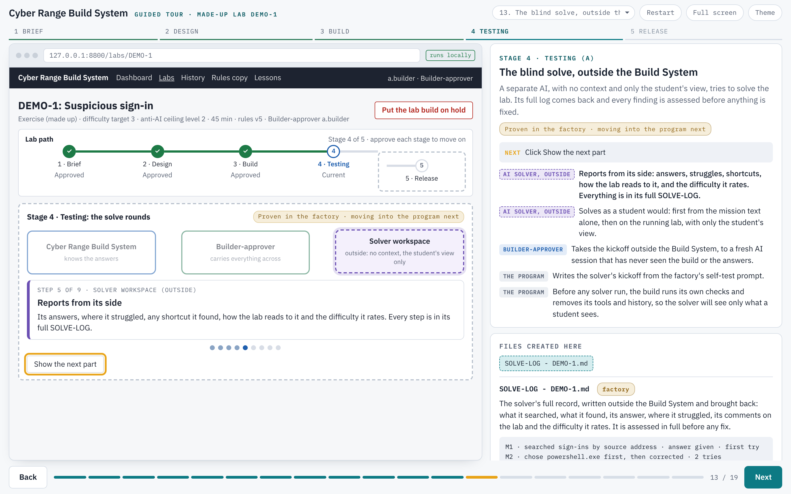
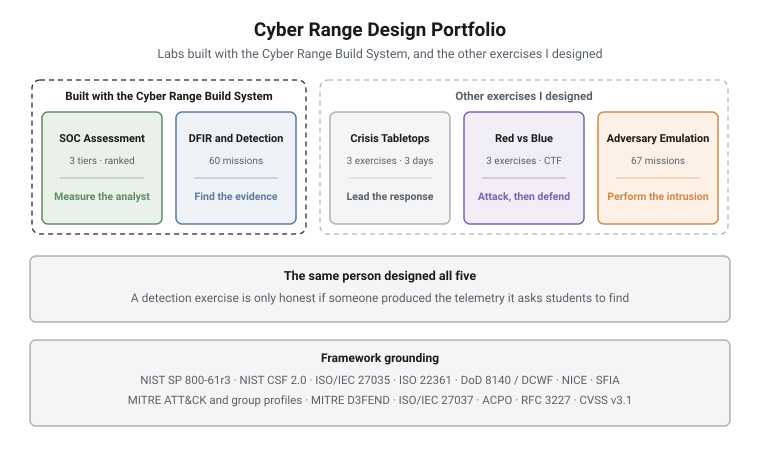

# Cyber Range Design

Cyber range labs and security exercises I designed and built, and the
**Cyber Range Build System**: the method behind the newest of them, now being
turned into a program.

## The Cyber Range Build System

One person turns a learning goal into a tested cyber range lab in five stages:
Brief, Design, Build, Testing and Release. An AI does the heavy work inside
fixed limits. A person approves every stage; the AI never does.

I built and proved the method in what I call the factory: the workspace where
my lab campaigns are designed, built, tested and released. The Build System is
the program that puts the same method into screens, so a team can use it.

**[Open the guided tour](https://fernandodeltaflows.github.io/cyber-range-design/build-system-tour/).**
It follows one made-up lab, DEMO-1, through every stage. No AI is called, and
every name, address and answer in it is invented.

---

## Contents

| Section | What it is |
|---|---|
| [Cyber Range Build System](#the-cyber-range-build-system) | The method and the program, with a [guided tour](https://fernandodeltaflows.github.io/cyber-range-design/build-system-tour/) |
| [SOC analyst assessment programme](ranges/soc-assessments/) | 3 scored, ranked tiers that measure whether an analyst can find an intrusion. Built with the method |
| [DFIR and detection range](ranges/dfir/) | 5 defensive campaigns, 60 missions. Built with the method |
| [Cyber crisis tabletop exercises](ranges/tabletop-exercises/) | 3 facilitated exercises for the people who lead a cyber crisis |
| [Red vs blue live exercises](ranges/red-blue-exercises/) | 3 live exercises where trainees attack an estate and then investigate it, plus a CTF event |
| [Adversary emulation range](ranges/adversary-emulation/) | 3 offensive campaigns, 67 missions |

On this page: [The five stages](#the-five-stages) · [What it built](#what-it-built) · [Where it stands](#where-it-stands) · [Other exercises I designed](#other-exercises-i-designed) · [Why both](#why-both) · [Framework grounding](#framework-grounding) · [AI-generated code](#teaching-students-to-distrust-ai-generated-code) · [Design constraints](#design-constraints) · [Research use](#research-use) · [What is not in this repository](#what-is-not-in-this-repository)

<picture>
  <source media="(prefers-color-scheme: dark)" srcset="diagrams/portfolio-overview-dark.svg">
  
</picture>

**3 crisis tabletop exercises, 3 red vs blue live exercises and a CTF event, a
3-tier assessment programme, and 8 training campaigns with 127 graded
missions.**
The assessments and ranges are built on a commercial cyber range platform for a
national cyber security training programme, and the tabletop series runs as
facilitated sessions for the same programme. The red vs blue exercises were
built for a government cyber academy.

**Answer keys and walkthroughs are deliberately not published.** These courses
are delivered commercially and the assessments are live. What is here is the
design: scenarios, chains, block structure, learning objectives, environment
topology, and the reasoning behind them.

---

## The five stages

| Stage | What happens | Where you can see it in the labs |
|---|---|---|
| **1 Brief** | The builder writes what the lab teaches or measures, for whom, at what level, the difficulty target, and how hard it must be for an AI to solve alone. The AI maps it to the frameworks and asks what only the person can decide | Each SOC tier is set by one DCWF work role and one starting position ([SOC programme](ranges/soc-assessments/)); each DFIR campaign by its learning outcomes |
| **2 Design** | The AI writes the story, the evidence, the missions and a fixed place for every answer. Each promise the design makes gets a check. The person questions it, then approves it | Framework grounding and mission maps in the SOC pages. In SOC III, 16 missions use 16 separate records, so no mission gives away another |
| **3 Build** | The AI turns the design into numbered build steps and scripts. The program checks every step, and risky steps wait for the person. Every graded answer is captured from the running lab, signed in as the student | SOC III: 28 days of authored activity, about 1.2 million events, with two intrusions inside ordinary business traffic |
| **4 Testing** | A separate AI with no context and only the student's view tries to solve the lab. Its full log is assessed and the person approves each fix. The difficulty is measured, not asserted. Then the build is cleaned and the person runs a release test | Across the three SOC tiers, an AI answered 1 of 49 questions from the mission text alone. Inside SOC III with full access, it failed 4 of 16 missions. See the [difficulty figures](ranges/soc-assessments/03-soc-iii-hunt-attribution.md#the-difficulty-instrument-demonstrated) |
| **5 Release** | The missions in the platform are checked against the design, the last review items are ticked, and a facilitator guide is produced | SOC III's delivered data matched the source exactly. All five DFIR campaigns were deployed and used |

In the program, stages 1 to 3 are built. Stages 4 and 5 run in the factory
today and move into the program next. See [Where it stands](#where-it-stands).

---

## What it built

These labs were built with the method, in the factory.

### [SOC analyst assessment programme](ranges/soc-assessments/) - 3 tiers

A separate product from the training ranges: an instrument that **measures**
whether an analyst can find an intrusion, rather than one that teaches them to.

| Tier | Assessment | Work role | Sector |
|---|---|---|---|
| I | [SIEM Intrusion Triage](ranges/soc-assessments/01-soc-i-siem-intrusion-triage.md) | DCWF 511 Cyber Defense Analyst | Financial services |
| II | [Intrusion Containment](ranges/soc-assessments/02-soc-ii-intrusion-containment.md) | DCWF 531 Cyber Defense Incident Responder | Electricity distribution |
| III | [Hunt & Attribution](ranges/soc-assessments/03-soc-iii-hunt-attribution.md) | DCWF 141 Threat/Warning Analyst | Telecommunications |

**49 missions over three tiers, live on the range in 8 weeks.** SOC III holds
28 days of authored activity, about 1.2 million events. An AI answered 1 of the
49 questions from the mission text alone; inside SOC III with full lab access,
it failed 4 of 16 missions.

Three two-hour, numerically scored assessments across three critical
infrastructure sectors. What the candidate is handed at minute zero is the
design: a detection, a foothold, or one external indicator and no incident.

Tiered against **DoD 8140 / DCWF** rather than an invented scale, with NICE
supplying the assessable task and skill statements. Architecture and framework
grounding are documented; mission content is not, for the reasons given on that
page.

### [DFIR and detection](ranges/dfir/) - 5 campaigns, 60 missions

Finding and reconstructing an intrusion from the evidence it leaves behind. One
continuity scenario across the week.

**First versions of all five campaigns in 4 days, then deployed and used.**

| Campaign | Focus | Missions |
|---|---|---|
| [Foundations & Evidence Orientation](ranges/dfir/01-foundations-evidence-orientation.md) | Evidence handling, chain of custody, orientation on the estate | 13 |
| [First-Response Triage](ranges/dfir/02-first-response-triage.md) | Work a live incident under first-response constraints | 11 |
| [Detection & Log Analysis](ranges/dfir/03-detection-log-analysis.md) | Validate alerts, separate true from false positives, scope indicators | 12 |
| [Triage & Severity Scoring](ranges/dfir/04-triage-severity-scoring.md) | Score three incidents with CVSS v3.1 and prioritise the queue | 12 |
| [Live Volatile Collection](ranges/dfir/05-live-volatile-collection.md) | Collect volatile evidence in order of volatility from a running host | 12 |

---

## Where it stands

The method is proven: the labs above were built with it. The program is built
through the Build stage and is in its final safety rounds.

**Built in the program**
- Accounts, roles, an add-only History, backups and AI cost caps
- Brief and Design with the AI: decisions, constraints, review and approvals
- The build plan with its safety checks, provisioning and the build-baseline
- The build steps, tested on stand-in machines
- The lessons loop, and the rules version each lab adopts

**Proven in the factory, moving into the program next**
- Testing: the blind solve outside the system, fix rounds the person approves,
  the difficulty locked
- The freeze and the release test
- Release: the platform check and the facilitator guide

**Next**
- The password checks in their new form, as in the factory (being built now)
- The final safety rounds
- A full consistency check and an independent QA
- The first real lab built on the platform

The tour's last screen compares ways to deliver it: as its own program (being
built), as a Claude plugin (assessed, not built), and with a Claude connector
to ask about it from a Claude chat (proposed, not started).

---

## Other exercises I designed

These were not built with the Build System method.

### [Cyber crisis tabletop exercises](ranges/tabletop-exercises/) - 3 exercises

Facilitated exercises for the people who make the decisions during a cyber
crisis, rather than the people at the console.

| Day | Exercise | Focus |
|---|---|---|
| 1 | [Capability and Classification](ranges/tabletop-exercises/01-capability-and-classification.md) | Map an incident response plan to the standards and write the rules for rating incidents |
| 2 | [Ransomware Response](ranges/tabletop-exercises/02-ransomware-response.md) | Lead a staged ransomware incident, then decide alone on payment and notification |
| 3 | [Capstone Close-out](ranges/tabletop-exercises/03-capstone-close-out.md) | Timeline, blameless review, board summary, regulator notice and response metrics |

One organisation and one incident run through all three days. Team work and
individual work are separated on purpose: incident command is assessed as a
team, and the decisions a leader is accountable for are assessed one person at
a time.

### [Red vs blue live exercises](ranges/red-blue-exercises/) - 3 exercises and a CTF

Live exercises on full Windows estates where trainees attack the estate and then
investigate the evidence their own attack left behind.

| # | Exercise | Led by | Focus |
|---|---|---|---|
| 1 | [Enterprise Intrusion Investigation](ranges/red-blue-exercises/01-enterprise-intrusion-investigation.md) | Blue | Reconstruct attack waves from endpoint telemetry and weeks of packet capture |
| 2 | [Insider Threat to Domain Compromise](ranges/red-blue-exercises/02-insider-to-domain-compromise.md) | Red, then blue | Take a domain on an APT-modelled path, then find every step in the SIEM |
| 3 | [Pivot into a Hardened Domain](ranges/red-blue-exercises/03-pivot-into-hardened-domain.md) | Red | Breach a second domain under a lockout policy, with exercise-control injects |
| 4 | [Capture the Flag Event](ranges/red-blue-exercises/04-ctf-event.md) | Event | One-day scored event for about 100 players in 24 teams |

Every host is imaged before and after the attack, so the blue phase works on a
compromise that was actually performed. Instructors play the victim and a Green
cell releases intelligence on request.

### [Adversary emulation](ranges/adversary-emulation/) - 3 campaigns, 67 missions

An authorised adversary-emulation progression against an isolated lab Active
Directory domain. Each day operates from the position the previous day reached.

| Campaign | Focus | Missions |
|---|---|---|
| [AD Enumeration & Path Discovery](ranges/adversary-emulation/01-ad-enumeration.md) | Profile a host and a domain, map the routes an adversary could travel | 19 |
| [Movement, Privilege Escalation, Persistence](ranges/adversary-emulation/02-movement-privesc-persistence.md) | Reuse token context, move laterally, escalate, establish persistence | 26 |
| [Stealth, Payload Handling, C2](ranges/adversary-emulation/03-stealth-payload-c2.md) | Operate against logging and in-memory defences, integrate with a C2 framework | 22 |

---

## Why both

The same person designed the range that emulates the intrusion and the range
that investigates it. That is deliberate.

A detection exercise is only honest if someone actually produced the telemetry
it asks students to find. An emulation exercise is only useful if you know what
the defender will see. Building both sides means the offensive range is written
with the evidence trail in mind, and the defensive range is built on artifacts
that a real technique actually leaves behind.

It also shows up inside the offensive campaigns, where every technique is
paired with the question of how it appears in the defender's telemetry. A
student who can run a domain enumeration but cannot tell a blue team which log
sources would have caught it has learned half the lesson.

---

## Framework grounding

Every exercise is written against published standards rather than an in-house
scheme, so the competencies assessed mean something outside the organisation
that issued them.

| Framework | Where it is used |
|---|---|
| **NIST SP 800-61r3** and **NIST CSF 2.0** | Tabletop series: the incident response life cycle and the governance frame around it |
| **ISO/IEC 27035** | Tabletop series: incident management phases and lessons learned |
| **ISO 22361** | Tabletop series: when an incident becomes a crisis |
| **DoD 8140 / DCWF** (DoDM 8140.03) | SOC programme: the primary tiering standard, work roles 511 / 531 / 141 |
| **NICE** (NIST SP 800-181r1) | SOC programme: assessable Task, Knowledge and Skill statements |
| **SFIA** | SOC programme: responsibility and autonomy levels |
| **MITRE D3FEND** (v1.3.0) | The defensive counterpart, across DFIR and the assessment programme |
| **MITRE ATT&CK** Enterprise | Adversary emulation and red vs blue exercises: technique-level mapping on every campaign and attack path |
| **ATT&CK group profiles** (APT28, APT29) | Red vs blue exercises: the adversary model for the domain-compromise path |
| **NIST SP 800-61** | DFIR: the incident response life cycle and its phase boundaries |
| **ISO/IEC 27037** | DFIR: identification, collection, acquisition and preservation of evidence |
| **ACPO** Good Practice Guide | DFIR: the handling principles applied to live decisions |
| **RFC 3227** | DFIR: order of volatility governing live collection |
| **CVSS v3.1** | DFIR: base metrics, scoring, and vector construction |

Each campaign page carries its own alignment table. The ATT&CK mapping is a
technique-level correspondence describing what a student actually performs, not
a formal control mapping.

---

## Teaching students to distrust AI-generated code

The adversary emulation range assesses something most offensive training does
not: **whether a student can critically review code a language model wrote for
them.**

Students are given AI-generated PowerShell and asked to find what is wrong with
it - a cmdlet that does not exist, a scope boundary the script quietly crosses -
and then to harden and run a corrected version. It appears in all three
campaigns and has a dedicated module in the third.

This was added because it is now how offensive scripts actually get written.
A student who runs generated code without reading it will eventually run
something that touches a host outside the engagement scope, and the time to
learn that is in a lab.

---

## Design constraints

These campaigns are graded and auto-scored, which makes assessment integrity a
design problem rather than an afterthought. Four constraints shaped every one:

- **Answers are anchored to the environment.** A graded answer must be
  derivable only by doing the work in the range. A mission whose answer can be
  produced without touching the environment measures nothing.
- **Difficulty is measured, not asserted.** What a mission was priced at, what
  a change was expected to do, and what a solver actually experienced are three
  different numbers and are kept apart.
- **Answer integrity is designed in, not patched on.** An answer that is
  readable on the host, or reachable without the taught skill, is not an
  assessment question.
- **Nothing ships unvalidated.** Mechanical checks before release, and a blind
  solve by someone who did not build it.

---

## Research use

These ranges and scored assessments are the starting point for a research
design that measures AI on both sides of a cyber attack, as the attacker and as
the defender: [ai-cyber-testbed](https://github.com/fernandodeltaflows/ai-cyber-testbed).
It is a design. No results exist yet.

---

## What is not in this repository

- Answer keys, accepted values, and walkthroughs
- The full mission list. Block structure and counts are published; the 127
  individual task statements are not, because they are live questions
- Assessment content. For the SOC programme, the architecture, its framework
  grounding and a few headline figures are published (mission and event
  counts, machine counts, difficulty against target). Mission text, scenario,
  band composition and answers are not
- The Build System program itself: its code, prompts and rules. The tour is a
  mock-up of its screens, run on a made-up lab
- Platform workbooks, build scripts, and telemetry generators
- Credentials, machine images, and internal addressing
- Course slide decks, student handouts and written assessments
- Tabletop facilitator notes, inject timing, model answers, worked examples and
  the Day 3 incident record
- Red vs blue estate names, addressing, accounts, command sequences, Green cell
  inject content, CTF challenge content and results

This documentation was authored from design sources rather than exported from
delivery material, so nothing withheld is recoverable from what is here. The
tour's lab, DEMO-1, is invented.

---

## Licence

Documentation licensed [CC BY 4.0](LICENSE). Published with the permission of
the clients for whom the courses and exercises were developed.

---

> **Confidentiality.** These cyber ranges were designed and built for private
> clients. This page documents design and architecture only. Scenario content,
> mission structure, answer keys and walkthroughs remain confidential, and are
> neither published here nor available on request.
