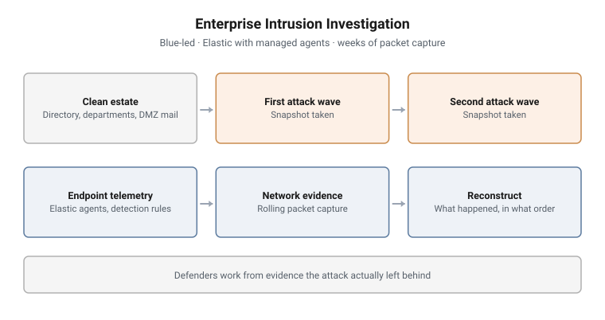

# Enterprise Intrusion Investigation

**Led by:** Blue · **Format:** Two live exercises in one series
**Telemetry:** Elastic with managed agents, rolling full packet capture
**Estate:** Enterprise Windows domains with servers, workstations and users

<picture>
  <source media="(prefers-color-scheme: dark)" srcset="../../diagrams/rb-01-enterprise-dark.svg">
  
</picture>

## Scenario

Two blue-led exercises on enterprise estates. In the first, the estate is
attacked in two waves and the defenders arrive afterwards, with endpoint
telemetry from every host and weeks of packet capture. The second adds a
restricted server, a mail service in a DMZ and a user population generated per
department, so the intrusion sits inside a working organisation. In both, the
defenders have to work out what happened.

## Objectives

- Orient on an unfamiliar estate and its normal activity
- Separate attack activity from a realistic user population
- Reconstruct each attack wave from endpoint telemetry
- Corroborate host findings with network evidence
- Produce an ordered account of the intrusion

## Structure and progression

1. **A clean estate is built and populated.** Department user populations are
   generated by script so the directory looks like a working organisation
2. **Monitoring goes live.** Elastic agents are enrolled through a managed
   fleet, detection rules are loaded, and the network log server starts a
   rolling capture
3. **First attack wave,** then a snapshot of every host
4. **Second attack wave,** then a second snapshot (first exercise)
5. **Blue phase.** Trainees investigate from the post-attack images, the SIEM
   and the packet capture

## What makes this hard

**Volume.** The packet capture covers weeks, not minutes. Finding the attack in
it means knowing what to look for before opening it.

**Two waves.** Attributing activity to the right wave, and seeing what the
second wave reused from the first, is harder than finding either one alone.

**Host and network have to agree.** A finding that appears on the host but has
no network trace, or the reverse, is a question, not an answer.

## Design notes

**Snapshots after each wave.** Keeping a post-attack image for each wave lets
control restart the blue phase from either point, and lets trainees compare the
estate before and after.

**A populated directory.** In the second exercise, scripted department users
give the estate enough normal activity that the intrusion has something to hide
in.

## Why this matters operationally

Most real investigations start after the fact, with whatever telemetry was
already being collected. Training on post-attack evidence, rather than watching
an attack live, matches how incident responders actually meet an intrusion.

## Framework alignment

| Framework | Alignment |
|---|---|
| **MITRE ATT&CK** | The techniques used in each attack wave |
| **NIST SP 800-61** | Detection and analysis, and the reconstruction of the incident |

---

> **Confidentiality.** These exercises were designed and built for a government
> client and are published with its permission. This page documents design and
> structure only. Estate details, credentials, scenario names, walkthroughs and
> answers remain confidential, and are neither published here nor available on
> request.
