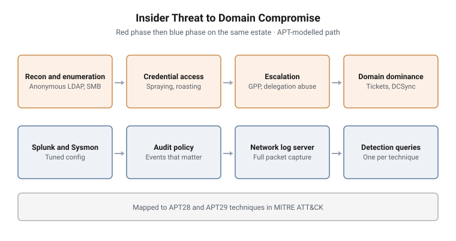

# Insider Threat to Domain Compromise

**Led by:** Red, then blue · **Format:** Live exercise in two phases
**Telemetry:** Splunk with forwarders, Sysmon, audit policy, full packet capture
**Adversary model:** APT28 and APT29 techniques, with an insider storyline

<picture>
  <source media="(prefers-color-scheme: dark)" srcset="../../diagrams/rb-02-domain-compromise-dark.svg">
  
</picture>

## Scenario

A company with a domain controller, a web server running an internal dashboard
and database, a file server and user workstations has an insider in its finance
department. Trainees start from the outside, find the insider's foothold, and
take the domain.

Then the estate is imaged as it stands, and the same trainees become the
defenders.

## Objectives

**Red phase**

- Discover hosts and services, and enumerate the directory without credentials
- Obtain a first credential, and escalate it to privileged access
- Move laterally between servers
- Reach domain dominance and understand how persistence would follow

**Blue phase**

- Find every step of the attack in the SIEM, the endpoint data and the packet
  capture
- Explain why each technique was or was not visible
- Write the detection that would have caught it

## Structure and progression

1. **Reconnaissance.** Live-host discovery and a DNS zone transfer
2. **Anonymous enumeration.** LDAP, RPC and SMB null sessions: users, groups,
   shares and the password policy
3. **Credential access.** A password left in a directory attribute, password
   spraying, and AS-REP roasting
4. **Escalation.** Group Policy Preferences credentials, Kerberoasting, and
   unconstrained delegation
5. **Lateral movement.** Pass-the-hash and pass-the-ticket between servers
6. **Domain dominance.** DCSync, with Golden Ticket persistence as the bridge to
   the next exercise
7. **Blue phase.** Investigation of the post-attack estate

A web track on the same estate covers server-side request forgery and SQL
injection against the internal application.

## What makes this hard

**Every step depends on the last.** A missed credential in enumeration closes
the rest of the path. Trainees learn to read what each step gives them.

**Some techniques are nearly silent.** Anonymous enumeration and roasting leave
little behind compared with lateral movement. The blue phase makes trainees
confront which of their own steps they would never have caught.

**The insider complicates attribution.** Activity from a legitimate account is
the hardest to call malicious.

## Design notes

**Mapped to real groups.** The path follows techniques documented for APT28
and APT29 in ATT&CK, so trainees work against a realistic adversary model, not
an invented one.

**Built for the detection.** A tuned Sysmon configuration, an audit policy
chosen for the events these attacks generate, and one Splunk query per
technique were written alongside the attack path.

**Same estate, both phases.** Trainees investigate the attack they performed,
which ties every technique to its evidence.

## Why this matters operationally

Directory misconfigurations, not exotic exploits, are how most domain
compromises happen. Training both the attack and its detection on the same
estate builds analysts who know what a real attack leaves behind.

## Framework alignment

| Framework | Alignment |
|---|---|
| **MITRE ATT&CK** | T1018, T1087, T1135, T1110.003, T1558.004, T1552.006, T1558.003, T1550.002, T1550.003, T1003.006, T1558.001 |
| **ATT&CK group profiles** | APT28 (G0007) and APT29 (G0016) |
| **NIST SP 800-61** | Detection and analysis in the blue phase |

---

> **Confidentiality.** These exercises were designed and built for a government
> client and are published with its permission. This page documents design and
> structure only. Estate details, credentials, scenario names, walkthroughs and
> answers remain confidential, and are neither published here nor available on
> request.
