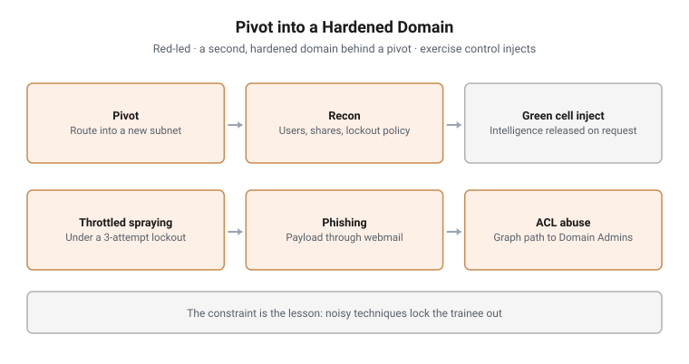

# Pivot into a Hardened Domain

**Led by:** Red · **Format:** Live exercise with exercise control
**Constraint:** Account lockout after three failed attempts
**Follows:** Insider Threat to Domain Compromise

<picture>
  <source media="(prefers-color-scheme: dark)" srcset="../../diagrams/rb-03-adversary-domain-dark.svg">
  
</picture>

## Scenario

The trail from the first exercise leads to a second, separate domain on another
subnet: a mail server, a file server, a domain controller and workstations,
configured with a strict lockout policy. Trainees have to route into it, find a
way in, and reach Domain Admins.

## Objectives

- Route into a new subnet through a pivot host
- Enumerate a domain and read its password policy before acting on it
- Spray credentials without triggering lockout
- Gain initial access through phishing
- Map the directory as a graph and find an access-control path to Domain Admins
- Abuse that path with the minimum change needed

## Structure and progression

1. **Pivot.** Add a route through the pivot host into the new subnet
2. **Reconnaissance.** RPC, SMB and full enumeration: users, groups and the
   lockout policy
3. **Green cell.** When trainees stall, they request intelligence from exercise
   control, such as a user and a leaked password list
4. **Throttled password spraying,** paced to stay under the lockout threshold
5. **Phishing.** A payload delivered through webmail. An instructor, playing
   the target user, opens it only when trainees request it
6. **Graph analysis.** BloodHound collection and a shortest path to Domain Admins
7. **ACL abuse.** Group membership and object permissions changed along that
   path

## What makes this hard

**The lockout policy.** Three failed attempts lock an account. Trainees who
spray as they did in the first exercise lock themselves out. Reading the policy
first is the lesson.

**Asking for intelligence.** The Green cell gives nothing unasked. Trainees have
to recognise when they are stuck and frame a request.

**The path is in permissions, not vulnerabilities.** No exploit is needed.
Trainees have to read access-control relationships and see the chain.

## Design notes

**A harder estate on purpose.** After the first exercise, a domain that
punishes noise forces trainees to slow down and plan.

**The victim is a person.** Having an instructor open the payload keeps
phishing inside the rules of engagement and makes the timing a control
decision.

**Injects on request.** Releasing information only when asked trains the habit
of identifying what is missing.

## Why this matters operationally

Real targets have lockout policies, monitored mail and permission sprawl.
Training against those constraints builds operators who plan before they act,
and analysts who understand why access-control paths are so often the way in.

## Framework alignment

| Framework | Alignment |
|---|---|
| **MITRE ATT&CK** | T1090, T1087, T1069, T1201, T1110.003, T1566.001, T1204.002, T1482, T1098, T1222 |
| **NIST SP 800-61** | The detection opportunities discussed in the debrief |

---

> **Confidentiality.** These exercises were designed and built for a government
> client and are published with its permission. This page documents design and
> structure only. Estate details, credentials, scenario names, walkthroughs and
> answers remain confidential, and are neither published here nor available on
> request.
