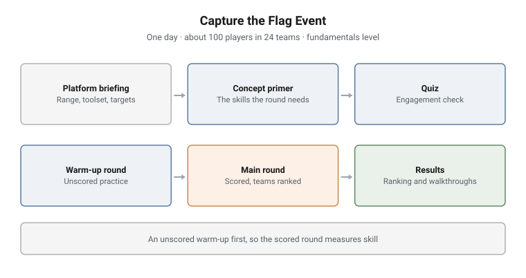

# Capture the Flag Event

**Format:** One-day scored event · **Players:** About 100, in 24 teams
**Audience:** Government and civilian trainees · **Level:** Fundamentals

<picture>
  <source media="(prefers-color-scheme: dark)" srcset="../../diagrams/rb-04-ctf-dark.svg">
  
</picture>

## What this was

A one-day capture the flag event on a commercial cyber range, run for about
100 players in 24 teams. I designed the event and ran it: the format, the
briefing, the rounds and the results. The challenge sets were
Linux fundamentals content run on the range.

## Objectives

- Get a large group, most of them new to the range, productive in one morning
- Practise Linux fundamentals under time pressure: SSH access, file links,
  file types, archives and file transfer
- Rank teams fairly and give every player feedback

## Structure of the day

1. **Platform briefing.** How the range works: credentials, the toolset and
   the targets
2. **Concept primer.** The specific skills the rounds need, taught just before
   they are needed
3. **Quiz.** A short engagement check before the clock starts
4. **Warm-up round.** Unscored practice on the same kind of challenge
5. **Main round.** Scored, with teams ranked on points
6. **Results.** Final ranking, followed by walkthroughs for every challenge

## Design notes

**A warm-up before the scored round.** Most players had never used the range.
An unscored round first means the scored round measures skill, not familiarity
with the interface.

**Walkthroughs after, not during.** Players get the full solutions once scoring
closes, so the event is also a lesson.

---

> **Confidentiality.** These exercises were designed and built for a government
> client and are published with its permission. This page documents design and
> structure only. Estate details, credentials, scenario names, walkthroughs and
> answers remain confidential, and are neither published here nor available on
> request.
