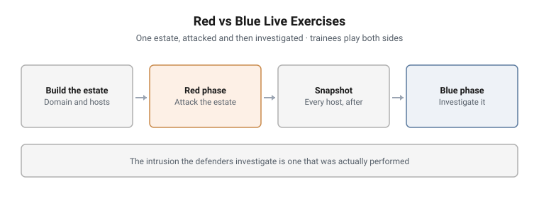

# Red vs Blue Live Exercises

Live, multi-host exercises built for a government cyber academy, where trainees
attack an estate and then investigate the evidence their own attack left
behind. I designed the exercises and led the build; colleagues on the
instructor team helped build parts of the environments.

| # | Exercise | Led by | What the trainees do |
|---|---|---|---|
| 1 | [Enterprise Intrusion Investigation](01-enterprise-intrusion-investigation.md) | Blue | Reconstruct two attack waves from endpoint telemetry and weeks of packet capture |
| 2 | [Insider Threat to Domain Compromise](02-insider-to-domain-compromise.md) | Red, then blue | Take a domain from an insider foothold, then find every step of it in the SIEM |
| 3 | [Pivot into a Hardened Domain](03-pivot-into-hardened-domain.md) | Red | Breach a second, hardened domain under a lockout policy, with exercise-control injects |
| 4 | [Capture the Flag Event](04-ctf-event.md) | Event | A one-day scored event for about 100 players in 24 teams |

<picture>
  <source media="(prefers-color-scheme: dark)" srcset="../../diagrams/rb-series-dark.svg">
  
</picture>

---

## The model: one estate, both sides

Each exercise is built around a single estate: a Windows domain with a
controller, servers and workstations, a web or mail service, an attacker host,
a SIEM, and a network log server capturing full packets.

**The red phase runs against pre-attack images.** Trainees work an authorised
attack path from reconnaissance to domain dominance.

**Every host is then imaged again, post-attack.** Those images, with the SIEM
data and the packet capture, become the blue phase. Trainees investigate the
compromise, technique by technique, on the same estate they just attacked.

This is what a purple team exercise is meant to teach. A trainee who has run a
Kerberoast and then has to find it in the authentication events learns both
halves of the technique, and learns why some techniques are loud and others are
not.

## What exercise control looks like

The exercises are not self-paced labs. They are run:

- **Instructors play the victim.** In the phishing stage, the payload only runs
  when an instructor, signed in as the target user, opens it. Trainees have to
  ask for it, which keeps the attack inside the rules of engagement.
- **A Green cell holds intelligence.** When trainees stall after
  reconnaissance, they can request information from exercise control, such as
  a username or a leaked password list. It is released on request, not handed
  out at the start, so trainees learn to ask the right question.
- **Snapshots between phases.** Clean, ready-to-go and post-attack images of
  each environment let control reset a phase or restart the blue side from a
  known state.

## Built for the detection, not only the attack

Every red technique is paired with the evidence it leaves. The blue side is
configured for that on purpose:

| Source | What it captures |
|---|---|
| Splunk or Elastic, with forwarders or managed agents | Windows Security, Sysmon and PowerShell events from every host |
| Sysmon with a tuned configuration | Process lineage, network connections, registry and image loads |
| Windows audit policy | The account, logon, Kerberos and directory-service events the attacks generate |
| Network log server | Full packet capture, rotated through the exercise window |
| Detection queries | One search per technique, written alongside the attack path |

## Grounded in published frameworks

| Framework | Where it is used |
|---|---|
| **MITRE ATT&CK** Enterprise | Technique-level mapping of every attack path |
| **ATT&CK group profiles** (APT28, APT29) | The adversary behaviour the domain-compromise path is modelled on |
| **NIST SP 800-61** | The incident response phases the blue side works through |

---

## Deliberately not documented here

Estate names, domain names, addressing, accounts and credentials, the detailed
command sequences, Green cell inject content, CTF challenge content, results,
and anything that identifies the client or its trainees.

---

> **Confidentiality.** These exercises were designed and built for a government
> client and are published with its permission. This page documents design and
> structure only. Estate details, credentials, scenario names, walkthroughs and
> answers remain confidential, and are neither published here nor available on
> request.
