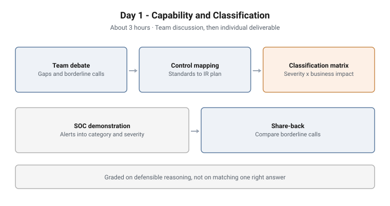

# Day 1 - Capability and Classification

**Format:** Facilitated tabletop · **Duration:** About 3 hours
**Structure:** Team discussion, then individual deliverable · **Grading:** Formative
**Sector:** Regional healthcare provider (financial services as an alternative)

<picture>
  <source media="(prefers-color-scheme: dark)" srcset="../../diagrams/ttx-01-capability-dark.svg">
  
</picture>

## Scenario

A mid-sized organisation is standing up an incident response capability for the
first time and has to align it to recognised standards. It has the constraints
most real organisations have: a small security team, a modest budget and
competing priorities.

The group acts as advisers helping it build that capability well, and then
writes the rules the organisation will use to rate every incident that follows.

## Objectives

- Map an incident response plan against NIST SP 800-61r3 and ISO/IEC 27035 and
  name each gap, overlap and area of weak coverage
- Recommend improvements that a resource-constrained organisation could actually
  implement
- Design a severity scale with observable criteria
- Add a business-impact dimension and combine both into a priority grid
- Validate the grid against the incidents this organisation is likely to face

## Structure and progression

1. **Team debate.** The group argues out where controls fall short and which
   incidents are genuinely hard to classify. The discussion deliberately does
   not converge on one answer: the differing views are what each participant
   works from next
2. **Control mapping (individual).** Standards phases mapped to the plan's
   sections, with every finding labelled and paired with a concrete fix
3. **Classification and prioritisation matrix (individual).** Severity, business
   impact and a priority grid, tested against likely incidents
4. **Technical demonstration.** The instructor shows how raw SOC alerts and
   indicators are correlated and triaged into a category, severity and impact:
   the inputs the matrix will consume
5. **Share-back.** Participants compare their matrices on the borderline calls

## What makes this hard

**Borderline incidents.** Clear cases classify themselves. The value of a
severity scale is in the cases that sit between two levels, and those are the
ones the group is pushed to name and argue.

**Observable criteria.** A severity definition that cannot be checked against
what the SOC actually sees is an opinion. The exercise rewards a few sharp,
testable definitions over many vague ones.

**Business harm, not technical effect.** In a healthcare setting the impact
dimension has to capture patient safety and regulated-data loss, not only which
systems were touched.

**Realism under constraint.** "Recovery is weak" is not a recommendation. A fix
with an owner and a defined criterion is.

## Design notes

**Discussion first, without consensus.** Letting the group agree on one answer
would hand every participant the same deliverable. Keeping the debate open
surfaces competing views and makes the individual work genuinely individual.

**The standard is used as a completeness checklist.** It shows what a plan is
missing rather than prescribing what it must say.

**The matrix is used again.** It is not an exercise artefact that is filed
away: the classification rules written here are applied to the live incident on
Day 2.

## Why this matters operationally

**Classification drives everything downstream.** Escalation, who is woken up,
when crisis management is activated and which notification clocks start all
depend on the severity an incident is given in its first hour.

**Immature plans fail in predictable places.** Post-incident review,
notification timelines and escalation thresholds are the gaps most often found,
and they are the ones that hurt most during a real incident.

## Framework alignment

| Framework | Alignment |
|---|---|
| **NIST SP 800-61r3** | Incident response phases mapped to the plan |
| **ISO/IEC 27035** | Incident management phases, used alongside NIST |
| **NIST CSF 2.0** | The governance frame the plan sits inside |

---

> **Confidentiality.** These exercises were designed and built for private
> clients. This page documents design and structure only. Scenario detail,
> facilitator material, model answers and worked examples remain confidential,
> and are neither published here nor available on request.
