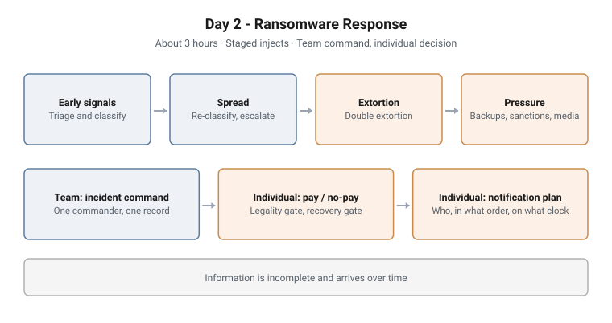

# Day 2 - Ransomware Response

**Format:** Facilitated tabletop with staged injects · **Duration:** About 3 hours
**Structure:** Team incident command, then individual decision drill · **Grading:** Formative
**Sector:** The Day 1 organisation

<picture>
  <source media="(prefers-color-scheme: dark)" srcset="../../diagrams/ttx-02-ransomware-dark.svg">
  
</picture>

## Scenario

A multi-stage ransomware incident hits the organisation from Day 1. It unfolds
in stages, and information is incomplete and arrives over time. The team leads
the response across the whole arc. Then each participant, alone, makes the two
calls an executive is accountable for: whether to pay, and who must be told.

## Objectives

- Triage and re-classify an incident as it develops, using the Day 1 matrix
- Apply an escalation matrix and decide when crisis management is activated
- Run incident command: one named commander, function leads and a RACI with one
  accountable owner per decision
- Run a response cadence and keep one shared incident record
- Handle evidence so that recovery does not destroy it
- Produce a reasoned pay / no-pay recommendation and a notification plan

## Structure and progression

The incident is released in four stages:

1. **Early signals.** Scattered endpoint alerts and a user who cannot open files
   on a shared drive
2. **Spread.** Encryption confirmed across several servers and a critical service
   degrading
3. **Extortion.** A ransom demand with a deadline, and signs that data left the
   estate before encryption
4. **Pressure.** Backups of uncertain quality, a threat group that may be
   sanctioned, and a journalist on the phone

Then two tasks:

- **Team: manage the incident.** Classification, escalation, command, cadence
  and the incident record, run by the group as a whole
- **Individual: pay / no-pay and notification drill.** A decision tree with a
  legality gate and a recovery gate, documented as an executive call, plus a
  notification plan covering who is notified, in what order and on what clock

A short instructor-run demonstration shows containment actions and their effect,
how SOC alerts reveal scope and spread, and how threat intelligence informs the
decision to assume a breach.

## What makes this hard

**The picture keeps changing.** Each stage invalidates part of the previous
classification. Participants who rate the incident once and stop re-rating it
fall behind it.

**Two independent gates.** Paying is only reachable if it is both lawful and the
only viable recovery. Most groups argue recovery first; the legality question is
the one that is easy to skip.

**Several clocks at once.** Once personal data is involved, data-protection,
sector and law-enforcement obligations can run in parallel, with different
deadlines and different audiences.

**Command under pressure.** Two people giving orders, or a decision with no
single accountable owner, is the failure the team task is built to expose.

## Design notes

**The live response is a team task on purpose.** Incident command is
irreducibly collective. Splitting it into individual work would assess something
other than command.

**The executive decision is individual on purpose.** The pay / no-pay call and
the notification plan are what a leader is personally accountable for, so each
participant produces their own. An optional one-line rationale logged at a
command gate captures individual reasoning inside the team task without breaking
the single-commander structure.

**The verdict is not graded.** Reasonable leaders differ. The grade reflects
whether the decision is justified against legality, risk and duty.

**Day 2 feeds Day 3.** The incident handled here is the one closed out in the
capstone, so the decisions made under pressure are the ones later reviewed.

## Why this matters operationally

**Ransomware decisions are made by executives, not analysts.** The technical
team can contain and restore; whether to pay, and what to disclose, sits with
leadership and carries legal exposure.

**Evidence is lost in recovery.** Rebuilding before imaging is the most common
way an organisation destroys the evidence it later needs for insurers,
regulators and law enforcement.

**Notification failures become their own incident.** A missed regulatory clock
or a board that hears about a breach from the press turns a technical incident
into a governance one.

## Framework alignment

| Framework | Alignment |
|---|---|
| **NIST SP 800-61r3** | Detection, analysis, containment and recovery activities |
| **ISO/IEC 27035** | Incident management and escalation |
| **ISO/IEC 27037** | Evidence identification, collection and chain of custody |
| **ISO 22361** | The point at which an incident is escalated to crisis management |

---

> **Confidentiality.** These exercises were designed and built for private
> clients. This page documents design and structure only. Scenario detail,
> facilitator material, model answers and worked examples remain confidential,
> and are neither published here nor available on request.
