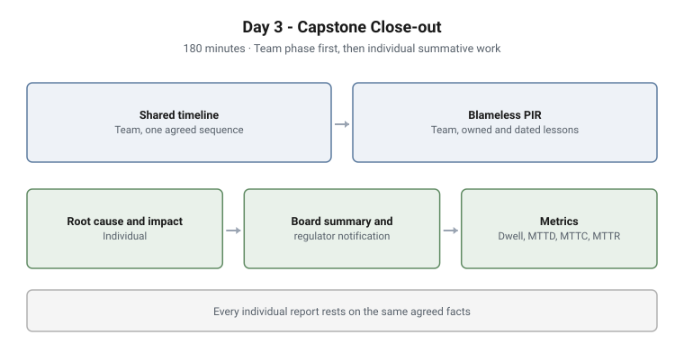

# Day 3 - Capstone Close-out

**Format:** Facilitated tabletop capstone · **Duration:** 180 minutes
**Structure:** Team phase, then individual summative work · **Grading:** Summative
**Sector:** The Day 1 organisation, after the Day 2 incident

<picture>
  <source media="(prefers-color-scheme: dark)" srcset="../../diagrams/ttx-03-capstone-dark.svg">
  
</picture>

## Scenario

The ransomware incident from Day 2, which also took customer personal data, has
been contained and recovered. The fire is out. Now the organisation has to close
it out properly: tell the board, tell the regulator, learn from it and measure
it.

The group is handed the incident record: timeline, decision log, notifications
and impact data. It is imperfect, as real records are.

## Objectives

- Rebuild one agreed timeline from an imperfect incident record
- Run a blameless post-incident review and turn it into owned, dated actions
- Take a root-cause analysis past the obvious answer to a systemic cause
- Quantify impact across several dimensions, including indirect cost
- Write a one-page board summary and the key points of a regulator notification
- Derive response metrics from the timeline and turn them into an improvement
  decision

## Structure and progression

**Team phase**

1. **Shared timeline.** One agreed sequence, with gaps and conflicts in the record
   resolved together
2. **Blameless post-incident review.** A neutral facilitator, ground rules, the
   timeline walked, findings sorted into what went well, what did not and what
   went right by luck, and three lessons recorded as owned, dated actions

**Individual phase**

3. **Root cause and impact.** 5 Whys and a fishbone to a systemic cause, and
   impact estimated as ranges with stated assumptions
4. **Board summary and regulator notification.** A one-page executive summary
   that leads with impact, cost and decision and ends with a clear ask, plus the
   key points of a factual regulator notice
5. **Metrics.** After a short demonstration of pulling them from an incident
   record: dwell time, time to detect, time to contain and time to recover, the
   biggest delay, and one or two metrics for a board scorecard

## What makes this hard

**"Someone clicked" is not a root cause.** The analysis has to reach the
systemic condition that let one click become an organisation-wide incident.

**Indirect cost is usually the largest cost.** Downtime, recovery effort,
regulatory exposure and lost trust outweigh the direct technical cost, and are
the hardest to estimate honestly.

**Blame creeps in.** A post-incident review that drifts into who was at fault
stops producing honest information. Keeping it blameless is a skill, not a
setting.

**The numbers have to drive a decision.** If dwell time dwarfs time to contain,
the improvement is better detection, not faster responders. A metric that does
not change a decision is decoration.

## Design notes

**Team phase first.** Every individual report rests on the same agreed facts,
so differences between participants reflect reasoning, not different readings
of the record.

**The review is collective; the report is personal.** The post-incident review
is a team product and is not individually graded. The report, board summary,
regulator notice and metrics are each participant's own summative evidence.

**Writing time is protected.** The board summary and report are the heaviest
item and get the largest block of the session, because writing for a board under
time pressure is the competency being assessed.

**Judged on discipline.** Honest reporting, a genuinely blameless review and
metrics that drive a decision, rather than reaching a particular answer.

## Why this matters operationally

**Boards act on one page.** An incident report that buries impact, cost and the
decision needed is a report that does not get acted on.

**Regulators read the notification, not the incident.** A notice that is late,
speculative or inconsistent with later findings creates exposure of its own.

**Lessons that are not owned and dated do not happen.** The post-incident review
exists to change something, and an action without an owner and a date is a
wish.

## Framework alignment

| Framework | Alignment |
|---|---|
| **NIST SP 800-61r3** | Post-incident activity, lessons learned and metrics |
| **ISO/IEC 27035** | Lessons learned and continual improvement of incident management |
| **NIST CSF 2.0** | Improvement as a governance outcome |

---

> **Confidentiality.** These exercises were designed and built for private
> clients. This page documents design and structure only. Scenario detail,
> facilitator material, model answers and worked examples remain confidential,
> and are neither published here nor available on request.
