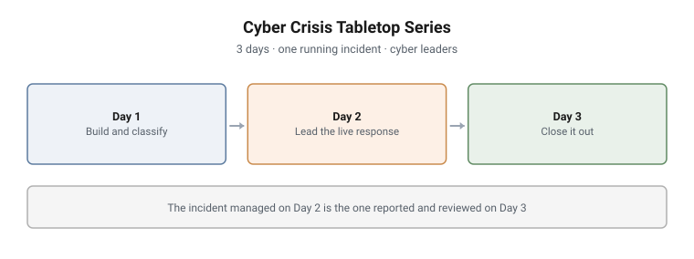

# Cyber Crisis Tabletop Series

A three-day series of facilitated tabletop exercises for the people who lead a
cyber incident rather than investigate it: incident response managers, SOC
managers, CISOs, risk and compliance leads, and public-sector and critical
infrastructure cyber teams.

| Day | Exercise | What the group is doing | Duration |
|---|---|---|---|
| **1** | [Capability and Classification](01-capability-and-classification.md) | Building an incident response capability and the rules for rating incidents | About 3 hours |
| **2** | [Ransomware Response](02-ransomware-response.md) | Leading a live, staged ransomware incident under incomplete information | About 3 hours |
| **3** | [Capstone Close-out](03-capstone-close-out.md) | Reporting, reviewing and measuring the incident they handled on Day 2 | 180 minutes |

**One organisation and one incident run through all three days.** The
capability built on Day 1 is the one tested on Day 2, and the incident led on
Day 2 is the one reported to the board and reviewed on Day 3.

<picture>
  <source media="(prefers-color-scheme: dark)" srcset="../../diagrams/ttx-series-dark.svg">
  
</picture>

---

## Why a tabletop and not a range

The ranges in this portfolio measure whether someone can find an intrusion in
telemetry. This series measures something a range cannot: **whether someone can
make and defend a decision when the technical picture is incomplete and the
clock is running.**

A crisis is decided in a room, not at a console. Whether to escalate to crisis
management, whether a ransom can lawfully be paid, who must be told and by when,
what goes in front of the board: none of these has an answer in a log file. They
are judgement calls made against law, risk and duty, and the only way to
practise them is to make them under realistic pressure and then defend them.

Each exercise still includes a short instructor-run technical demonstration, so
the decisions stay connected to what the SOC actually sees: how raw alerts turn
into a category and a severity, how containment shows up in telemetry, and how
response metrics are pulled from an incident record.

## Team work and individual work, deliberately separated

Every exercise has a team component and an individual component, and the split
is a design decision rather than a convenience.

| Team (collaborative) | Individual (graded per participant) |
|---|---|
| Debating gaps and borderline severity calls | Control mapping and classification matrix |
| Incident command: one commander, one record, coordinated functions | Pay / no-pay recommendation and notification plan |
| Shared timeline and blameless post-incident review | Incident report, board summary, regulator notification and metrics |

**Incident command is a team competency.** One commander, one record and
coordinated functions cannot be assessed one person at a time, so the live
response is run by the group.

**Decisions are individual.** The calls a leader is accountable for are worked
alone, so the grade reflects each participant's own reasoning rather than the
loudest voice at the table. Where the team phase comes first, it gives everyone
the same agreed facts to reason from.

## Graded on reasoning, not on the verdict

Reasonable leaders reach different conclusions on a pay / no-pay call or on a
borderline severity rating. The series rewards a decision that can be defended
against the standards, the law and the organisation's risk, not agreement with
a model answer. Days 1 and 2 are formative; the Day 3 capstone is the
summative evidence. Pre- and post-course written assessments sit around the
series.

## Grounded in published standards

| Framework | Where it is used |
|---|---|
| **NIST SP 800-61r3** | The incident response life cycle the capability is mapped against, all three days |
| **NIST CSF 2.0** | The governance frame the incident response plan sits inside |
| **ISO/IEC 27035** | Incident management phases, used alongside NIST for the Day 1 control mapping |
| **ISO/IEC 27037** | Evidence handling and chain of custody during the Day 2 response |
| **ISO 22361** | Crisis management: where an incident becomes a crisis, and what changes when it does |
| **Data-protection breach notification** | The notification clocks that run in parallel once personal data is involved |

---

## Deliberately not documented here

Facilitator notes, inject timing, model answers, worked examples, the incident
record handed out on Day 3, and the specific regulatory regime the scenario sits
in. The structure of each exercise is shown; how a facilitator steers the room
and what a strong answer looks like are not.

---

> **Confidentiality.** These exercises were designed and built for private
> clients. This page documents design and structure only. Scenario detail,
> facilitator material, model answers and worked examples remain confidential,
> and are neither published here nor available on request.
